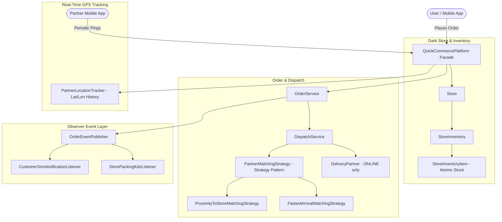

# Quick Commerce Delivery Platform — Low-Level Design (LLD)

[](https://openjdk.org/projects/jdk/21/)
[](pom.xml)
[](src/test/java/com/quickcommerce)
[](QuickCommerceSchema.md)

A production-grade, object-oriented Low-Level Design (LLD) for a **Quick Commerce Delivery Platform** (Zepto / Blinkit / Instamart style 10-minute grocery delivery) in Java 21 LTS adhering to clean architecture, SOLID principles, and Gang of Four (GoF) design patterns.

---

## 1. System Requirements & Domain Feature Matrix

| # | Requirement | Implementation Details | Design Pattern / Component |
| :---: | :--- | :--- | :--- |
| **1** | **Multi-Store Dark Store Network** | Network of localized dark stores with inventory catalogs and geolocations. | `Store`, `Location`, `Address` |
| **2** | **Atomic Inventory Reservation** | All-or-nothing stock reservation prior to order confirmation; guarantees 0 partial order failures. | `StoreInventory`, `StoreInventoryItem` |
| **3** | **Online / Offline Partner Filtering** | Strict status filtering: only `ONLINE` available delivery partners considered for task dispatch. | `PartnerStatus`, `DeliveryPartner` |
| **4** | **Proximity Dispatch Strategy** | Distance-based partner matching assigning the closest online partner to the pickup store. | `PartnerMatchingStrategy`, `ProximityToStoreMatchingStrategy` (Strategy Pattern) |
| **5** | **Real-Time GPS Location Tracking** | Ingestion of periodic location pings every few seconds from partner mobile apps with trajectory history. | `PartnerLocationTracker`, `LocationPing` |
| **6** | **Observer Event Notification Bus** | Decoupled event bus broadcasting live order status to customer SMS alerts and store packing screens. | `OrderEventPublisher`, `OrderEventListener` (Observer Pattern) |
| **7** | **Platform Facade** | Unified entry point coordinating Dark Stores, Delivery Partners, Orders, and GPS Tracking. | `QuickCommercePlatform` (Facade Pattern) |

---

## 2. Architecture Diagram



---

## 3. Test Verification
```bash
mvn clean test
```
- **7 unit & integration tests passing with 100% success**.
- Atomic inventory reservation tests verifying all-or-nothing rollback when stock is insufficient.
- Strategy pattern tests verifying closest online partner selection and vehicle-speed weighted fastest arrival.

